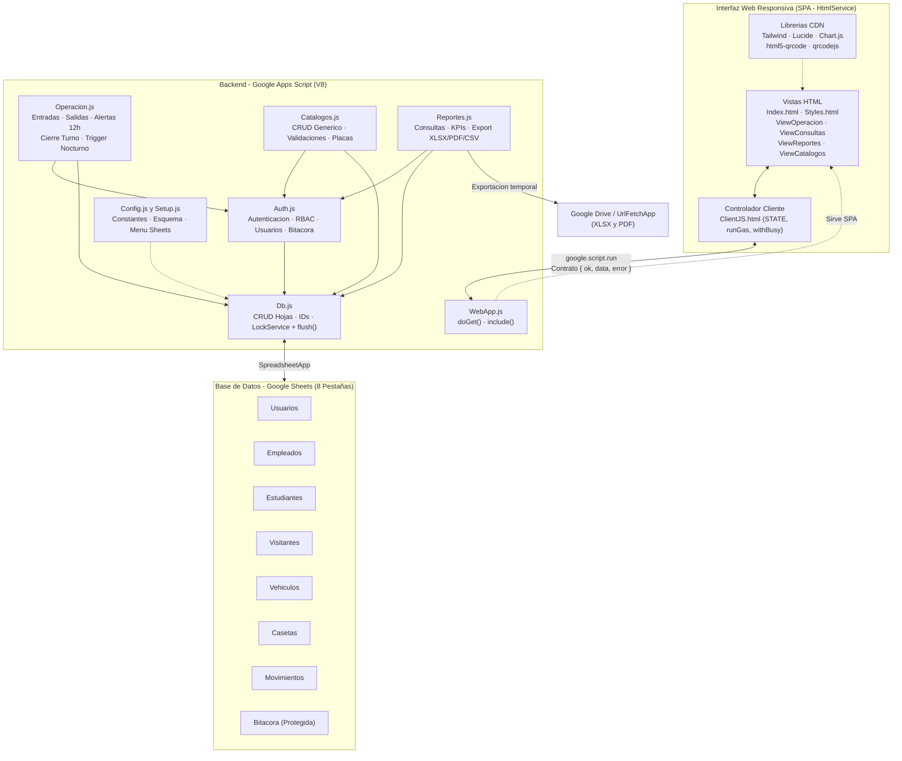

# Sistema de Control de Acceso Vehicular — UAT CUTM Sur

```text
  .:.           ..     ..       .:::::.      
  : :   :.:   .-:::.   .::.   :-:    .:.:.   
  : :----.: .:::-::::. .:.        :-. ::::.  
  :::   .:: ::.    .::..::::::. .:----:.     
                                             
                                             
                 .:::::::::.                 
             .::. :-::::::: .:::             
            :=:   .:.....::.  :=-.           
          .--:.:  ..     .:. .::--.            _____    ___    _   _   ___   ____     ___  
         .: . .: .:=====-=:. :. . :.          | ____|  / _ \  | | | | |_ _| |  _ \   / _ \ 
         :.   .: .:.      :. :.    :.         |  _|   | | | | | | | |  | |  | |_) | | | | |
        .: :-   .--       :=:   -: :.         | |___  | |_| | | |_| |  | |  |  __/  | |_| |
         .::==:....       .....:=:::          |_____|  \__\_\  \___/  |___| |_|      \___/ 
         .:-=                   :=-.         
         .:-=                   :=-.              _   _    ___    ____    _       _____    
         :::-:                 ::=::             | \ | |  / _ \  | __ )  | |     | ____|   
        .:::-:::   .:.....   :::-::-.            |  \| | | | | | |  _ \  | |     |  _|     
        .:.:=-====:::::::::-=-=-=-:=:            | |\  | | |_| | | |_) | | |___  | |___    
        .:--: .:::-==:  .-=-::. .::-.            |_| \_|  \___/  |____/  |_____| |_____|   
          :.:.  ..:::   .:-:  ..:.:.         
           ::.:-: .::: .::.::::.::.          
             :-:. .::: .::..::::  .::.-::::=.
                .::.:: :::::.                
                   :::::::.         :*####-  
                                    -++++++  
                                    =******. 
                                    .-+**=:  
```


-334155)

Plataforma web responsiva desarrollada sobre **Google Apps Script (V8)** y **Google Sheets** para digitalizar el registro, validación, monitoreo y análisis estadístico de accesos vehiculares en las **3 casetas del Centro Universitario Tampico-Madero (CUTM) Sur** de la **Universidad Autónoma de Tamaulipas (UAT)**.

- **Aplicación Web — Producción (Interfaz completa):** [Abrir Control Vehicular UAT CUTM Sur](https://script.google.com/macros/s/AKfycbzQzXCVaQZ72Kudd1nu5yBDHOZREF1hhvuQ7tYc5FLj/dev) *(requiere cuenta institucional UAT dada de alta)*
- **Entorno de pruebas (Backend base):** [Abrir implementación de pruebas (Backend)](https://script.google.com/macros/s/AKfycbwRXo2hpDsyF3wKqRKGxudVQQdebz-vWdCSVLe5_ZA4GOgXVgRWnMw2k9eJdJj-jG529g/exec) *(implementación inicial de verificación de backend)*
- **Repositorio oficial:** [https://github.com/AlanGDX/control-vehicular-uat](https://github.com/AlanGDX/control-vehicular-uat)
- **Administración / Soporte de acceso:** `a2221330007@alumnos.uat.edu.mx`

---

## Tabla de contenidos

1. [Descripción general y objetivo](#1-descripción-general-y-objetivo)
2. [Características principales](#2-características-principales)
3. [Arquitectura y modelo de datos](#3-arquitectura-y-modelo-de-datos)
4. [Estructura del repositorio](#4-estructura-del-repositorio)
5. [Guía de instalación y despliegue](#5-guía-de-instalación-y-despliegue)
6. [Control de seguridad y permisos](#6-control-de-seguridad-y-permisos)
7. [Estándares de calidad y documentación del proyecto](#7-estándares-de-calidad-y-documentación-del-proyecto)
8. [Transparencia en el uso de Inteligencia Artificial](#8-transparencia-en-el-uso-de-inteligencia-artificial)
9. [Equipo de desarrollo y créditos institucionales](#9-equipo-de-desarrollo-y-créditos-institucionales)

---

## 1. Descripción general y objetivo

### Problemática

El registro manual en bitácoras de papel en las tres casetas de acceso del **Centro Universitario Tampico-Madero (CUTM) Sur** (`Caseta 1 - Acceso Principal`, `Caseta 2 - Acceso Norte` y `Caseta 3 - Acceso Sur`) dificulta la validación inmediata de vehículos autorizados, impide conocer en tiempo real qué unidades permanecen dentro del campus y hace inviable generar consultas históricas, detectar estancias irregulares o producir reportes estadísticos oportunos.

### Objetivo

Digitalizar integralmente el control de entradas y salidas vehiculares mediante una **aplicación web de una sola página (SPA) responsiva** —operativa tanto en teléfonos móviles en caseta como en equipos de escritorio— respaldada por **Google Apps Script** y **Google Sheets**, sin costos adicionales de infraestructura externa y con control de acceso basado en cuentas institucionales de la UAT.

### Stack tecnológico

| Capa | Tecnología / Herramienta | Propósito |
|---|---|---|
| **Backend y API** | Google Apps Script (Runtime `V8`, `America/Monterrey`) | Lógica de negocio, autenticación, RBAC, control de concurrencia (`LockService`), triggers automáticos y exportación |
| **Base de datos** | Google Sheets (8 hojas normalizadas) | Persistencia estructurada, validaciones nativas, formato de claves y bitácora protegida |
| **Frontend (SPA)** | `HtmlService` (HTML5, CSS3, JavaScript ES6+) | Interfaz táctica de alto contraste para exteriores (`≥360px` a escritorio) sin paso de compilación |
| **Estilos e iconos** | Tailwind CSS (CDN Play), Google Fonts (`Plus Jakarta Sans`, `Inter`, `JetBrains Mono`), Lucide Icons `0.460.0` | Diseño responsivo, legibilidad tabular de placas y marcas de tiempo |
| **Gráficas y QR** | Chart.js `4.4.7`, `html5-qrcode` `2.3.8`, `qrcodejs` `1.0.0` | Dashboard analítico, escaneo QR en caseta y emisión de calcomanías QR imprimibles (`80 mm`) |
| **Sincronización CLI** | `@google/clasp` | Despliegue y versionado de `src/` entre GitHub y Apps Script |

---

## 2. Características principales

### Catálogos
- **Gestión CRUD de 5 catálogos maestros:** `Vehiculos`, `Empleados`, `Estudiantes`, `Visitantes` y `Casetas`.
- **Normalización y validación estricta:** las placas se normalizan automáticamente a mayúsculas alfanuméricas sin guiones ni espacios (ej. `abc-12 3` → `ABC123`, longitud de 5 a 8 caracteres `^[A-Z0-9]{5,8}$`). Validación de unicidad para placas, matrículas, números de empleado y nombres de caseta, además de formato de correo y teléfono a 10 dígitos.
- **Integridad referencial:** cada vehículo se vincula y valida contra el catálogo de su titular (`Estudiante`, `Docente`, `Administrativo` o `Visitante`), verificando la correspondencia entre el tipo de empleado y el tipo de titular. Los registros con relaciones activas o movimientos históricos no pueden eliminarse físicamente (se promueve su desactivación).
- **Pase Vehicular QR imprimible:** generación de calcomanías QR de baja densidad (`QRCode.CorrectLevel.M`, tarjeta de `80 mm` optimizada con `@media print`) codificando únicamente la placa normalizada para agilizar el escaneo bajo luz solar.

### Operación
- **Registro de entradas y salidas en caseta:** identificación de la caseta activa, captura automática de fecha y hora (`America/Monterrey`) y registro del operador autenticado.
- **Captura rápida multicanal:** entrada por teclado con autocompletado por prefijo (`buscarVehiculoPorPlaca`, mínimo 2 caracteres), soporte para lectores QR físicos USB/Bluetooth (interceptación de tecla `Enter`) y lector QR integrado con detección automática de `Permissions-Policy` del iframe de Apps Script (alternativa directa a cámara nativa del dispositivo vía captura de imagen o galería con `html5-qrcode`).
- **Control de visitantes y bajas:** los vehículos no registrados pueden ingresarse como `Visitante` con captura rápida opcional al catálogo y observación automática; los vehículos dados de baja son rechazados.
- **Reglas de consistencia y concurrencia:** uso de `LockService.getScriptLock()` con `SpreadsheetApp.flush()` antes de liberar el bloqueo para evitar entradas o salidas duplicadas ante peticiones simultáneas en las 3 casetas. Impide registrar entrada si el vehículo ya se encuentra `DENTRO` ese mismo día y rechaza salidas duplicadas.
- **Panel "En Campus" y alertas de estancia:** monitoreo en vivo con actualización automática cada 60 s (y al regresar a la pestaña), resaltando con alerta visual los vehículos cuya estancia supera `12 horas` (`CONFIG.HORAS_ALERTA_ESTANCIA`).
- **Cierre de turno y cierre nocturno automático:** los operadores registran el cierre de turno por caseta en bitácora; además, un activador diario programado (`23:00–23:59`) y la detección de entradas abiertas de días anteriores marcan automáticamente los movimientos inconclusos como `SIN SALIDA` (sin alterar `FechaHoraSalida`).

### Consultas
- **Filtros combinables en tiempo real:** consulta histórica de movimientos filtrando por **placa**, **rango de fechas** (`desde` / `hasta`), **caseta** (de entrada o salida), **tipo de usuario** (`Estudiante`, `Docente`, `Administrativo`, `Visitante`) y **estado** (`DENTRO`, `SALIO`, `SIN SALIDA`).
- **Trazabilidad directa:** resultados ordenados cronológicamente (más recientes primero) y navegación directa desde el ranking de vehículos frecuentes hacia el historial filtrado de esa placa.
- **Subvista de Bitácora de Actividades:** pestaña exclusiva para administradores con filtros por usuario, acción y rango de fechas (hasta 500 eventos recientes).

### Reportes
- **Indicadores clave (KPIs):** total de entradas, total de salidas, vehículos actualmente dentro, vehículos únicos, hora pico de afluencia, estancia promedio en minutos y bloque de control operativo (salidas no registradas, porcentaje sin salida y alertas de estancia `≥ 12 h`).
- **Visualizaciones interactivas (Chart.js):**
  1. Horarios de mayor afluencia (distribución por hora `00:00–23:00`).
  2. Comparativa de entradas y registros `SIN SALIDA` por caseta.
  3. Distribución por tipo de usuario.
  4. Tendencia diaria de movimientos y salidas no registradas.
- **Ranking de vehículos más frecuentes:** tabla Top 10 con placa, titular, tipo de usuario y número de visitas.
- **Exportación multi-formato:** descarga directa desde el navegador (conversión Base64 → `Blob`) en **Excel (`.xlsx`)**, **PDF (`.pdf`)** horizontal tamaño carta y **CSV (`.csv` UTF-8 con BOM)** aplicando los filtros activos.

### Seguridad
- **Acceso restringido por dominio institucional:** autenticación automática vía cuenta Google filtrada a `uat.edu.mx`, `docentes.uat.edu.mx` y `alumnos.uat.edu.mx` más verificación en la hoja `Usuarios`.
- **RBAC de doble capa:** los permisos se validan obligatoriamente en cada función del servidor (`api_()` / `requiere_()`) y controlan dinámicamente las vistas y acciones de la interfaz (`[data-perm]` y `VIEW_PERMS`).
- **Gestión centralizada de usuarios y auditoría:** alta/edición/activación desde el módulo de usuarios (con sincronización automática de permisos de edición del libro) y registro continuo de acciones y accesos denegados en la hoja protegida `Bitacora`.

---

## 3. Arquitectura y modelo de datos

### Diagrama de arquitectura



### Modelo de datos en Google Sheets

Todas las pestañas se crean y configuran automáticamente al ejecutar `setupInicial()` (`src/Setup.js`). La primera columna de cada hoja es siempre `ID`, generado con prefijo legible (`<PREF>-YYYYMMDD-XXXXXX`, por ejemplo `VEH-20261119-AB12CD`).

| Pestaña | Columnas exactas | Campos obligatorios | Reglas y relaciones principales |
|---|---|---|---|
| `Usuarios` | `ID`, `Correo`, `Nombre`, `Rol`, `CasetaAsignada`, `Activo`, `FechaAlta`, `UltimoAcceso` | `Correo`, `Nombre`, `Rol` | Correo institucional único; lista desplegable en `Rol` (`Administrador`, `Operador de Caseta`, `Consulta`). |
| `Empleados` | `ID`, `NumEmpleado`, `Nombre`, `Tipo`, `Departamento`, `Correo`, `Telefono`, `Activo` | `NumEmpleado`, `Nombre`, `Tipo` | `NumEmpleado` único; lista desplegable en `Tipo` (`Docente`, `Administrativo`). Referenciado por `Vehiculos.TitularID`. |
| `Estudiantes` | `ID`, `Matricula`, `Nombre`, `Carrera`, `Correo`, `Telefono`, `Activo` | `Matricula`, `Nombre` | `Matricula` única con formato texto (`@`) para preservar ceros iniciales. Referenciado por `Vehiculos.TitularID`. |
| `Visitantes` | `ID`, `Nombre`, `Identificacion`, `Motivo`, `Telefono`, `FechaRegistro` | `Nombre`, `Identificacion` | Alta manual en catálogos o registro rápido desde caseta. Referenciado opcionalmente por `Vehiculos.TitularID`. |
| `Vehiculos` | `ID`, `Placa`, `Marca`, `Modelo`, `Color`, `TipoTitular`, `TitularID`, `TitularNombre`, `Activo`, `FechaAlta` | `Placa`, `TipoTitular` | `Placa` única normalizada (`5–8` alfanuméricos, formato texto `@`); `TipoTitular` validado (`Estudiante`, `Docente`, `Administrativo`, `Visitante`); integridad referencial con el titular. |
| `Casetas` | `ID`, `Nombre`, `Ubicacion`, `Tipo`, `Activa` | `Nombre` | `Nombre` único. Semilla inicial: `Caseta 1 - Acceso Principal`, `Caseta 2 - Acceso Norte`, `Caseta 3 - Acceso Sur`. |
| `Movimientos` | `ID`, `Placa`, `VehiculoID`, `TipoUsuario`, `TitularNombre`, `CasetaEntradaID`, `CasetaEntrada`, `FechaHoraEntrada`, `OperadorEntrada`, `CasetaSalidaID`, `CasetaSalida`, `FechaHoraSalida`, `OperadorSalida`, `Estado`, `Observaciones` | `Placa`, `CasetaEntradaID` | `Placa` en texto (`@`); lista desplegable en `TipoUsuario` y `Estado` (`DENTRO`, `SALIO`, `SIN SALIDA`). Referencia a `Vehiculos` y `Casetas`. |
| `Bitacora` | `ID`, `FechaHora`, `Usuario`, `Rol`, `Accion`, `Modulo`, `Detalle` | Generados por el sistema | Hoja protegida con advertencia (`setWarningOnly(true)`). Registra automáticamente auditoría de seguridad y operación. |

> Para consultar la especificación completa de endpoints del servidor (`google.script.run`) y la matriz de integración cliente-servidor, revise [BACKEND.md](BACKEND.md) y [FRONTEND.md](FRONTEND.md).

---

## 4. Estructura del repositorio

> **Nota sobre extensiones:** conforme a `.clasp.json` (`"scriptExtensions": [".js", ".gs"]`), los módulos del servidor se versionan en Git como `.js` dentro de `src/` y se sincronizan en Google Apps Script como archivos `.gs`.

```text
control-vehicular-uat/
├── .clasp.json
├── .gitignore
├── BACKEND.md
├── FRONTEND.md
├── MANUAL_USUARIO.md
├── README.md
├── docs/
│   ├── Entregable_6_Evidencias_Levantamiento_UAT_v2.pdf
│   ├── Figura 1 — Diagrama Entidad-Relación.drawio.png
│   ├── Figura 2 — Diagrama de Actividades (Flujo Operativo).drawio.png
│   ├── Figura 3 — Diagrama de Casos de Uso.drawio.png
│   ├── MANUAL_USUARIO.pdf
│   └── SRS_Control_Acceso_Vehicular_UAT_v3.1.pdf
└── src/
    ├── appsscript.json
    ├── Auth.js
    ├── Catalogos.js
    ├── ClientJS.html
    ├── Config.js
    ├── Db.js
    ├── Index.html
    ├── Operacion.js
    ├── Reportes.js
    ├── Setup.js
    ├── Styles.html
    ├── ViewCatalogos.html
    ├── ViewConsultas.html
    ├── ViewOperacion.html
    ├── ViewReportes.html
    └── WebApp.js
```

### Propósito de cada archivo

| Archivo | Capa | Descripción |
|---|---|---|
| `.clasp.json` | Configuración | Configuración de `@google/clasp` (`rootDir: "src"`, extensiones `.js`/`.gs`/`.html`/`.json` y vínculo con `scriptId`). |
| `.gitignore` | Configuración | Exclusiones de control de versiones (`referencia_stitch/`). |
| `BACKEND.md` | Documentación | Guía técnica del backend, catálogo de funciones API y reglas de negocio. |
| `FRONTEND.md` | Documentación | Documentación técnica de la SPA, sistema de diseño, matriz de llamadas `runGas()` y decisiones de UI. |
| `MANUAL_USUARIO.md` | Documentación | Manual de operación y administración paso a paso por rol (v1.0.0), incluye FAQ y glosario. |
| `docs/MANUAL_USUARIO.pdf` | Documentación | Versión oficial en PDF (25 páginas) del Manual de Usuario con portada institucional y 9 figuras con capturas reales. |
| `docs/SRS_Control_Acceso_Vehicular_UAT_v3.1.pdf` | Documentación | Especificación de Requisitos de Software (SRS v3.1, 26 páginas) alineada a IEEE 830, ISO/IEC/IEEE 29148 e ISO/IEC 25010, incluyendo matriz de trazabilidad y evidencias de uso de IA. |
| `docs/Entregable_6_Evidencias_Levantamiento_UAT_v2.pdf` | Documentación | Evidencias del levantamiento presencial de requisitos en caseta (20/11/2026), registro fotográfico y formato físico vigente. |
| `docs/Figura 1 — Diagrama Entidad-Relación.drawio.png` | Diagramas | Diagrama Entidad-Relación de las 8 pestañas normalizadas de Google Sheets y sus relaciones. |
| `docs/Figura 2 — Diagrama de Actividades (Flujo Operativo).drawio.png` | Diagramas | Diagrama UML de actividades del flujo operativo en caseta, control de concurrencia y Cierre de Turno. |
| `docs/Figura 3 — Diagrama de Casos de Uso.drawio.png` | Diagramas | Diagrama UML de casos de uso para los 3 roles (`Administrador`, `Operador de Caseta` y `Consulta`). |
| `README.md` | Documentación | Documentación general del repositorio, arquitectura, despliegue, seguridad y transparencia de IA. |
| `src/appsscript.json` | Manifiesto GAS | Runtime `V8`, zona horaria `America/Monterrey`, registro `STACKDRIVER`, 7 scopes OAuth y configuración `webapp`. |
| `src/Config.js` | Backend | Constantes globales (`DOMINIOS_PERMITIDOS`, `ADMIN_INICIAL`, `HORAS_ALERTA_ESTANCIA`, `HORA_CIERRE_NOCTURNO`), `ESTADOS`, `ROLES`, `PERMISOS`, esquema `HOJAS`, `CATALOGOS` y `REQUERIDOS`. |
| `src/Db.js` | Backend | Capa de acceso a datos sobre Google Sheets (`leerTodos_`, `buscarPorId_`, `insertar_`, `actualizar_`, `eliminar_`), generación de IDs, serialización ISO y control de concurrencia `conBloqueo_()` con `LockService` y `SpreadsheetApp.flush()`. |
| `src/Setup.js` | Backend | Inicialización de las 8 hojas, formatos, validaciones de datos, protección de `Bitacora`, datos semilla de las 3 casetas y admin inicial, menú personalizado **Control Vehicular** (`onOpen`) y carga de datos de prueba (`cargarDatosPrueba`). |
| `src/Auth.js` | Backend | Autenticación por cuenta Google institucional (`login`), verificación de permisos (`requiere_`, `api_`), CRUD de usuarios, gestión de acceso al libro (`darAccesoHoja_` / `quitarAccesoHoja_`) y registro/consulta de `Bitacora`. |
| `src/Catalogos.js` | Backend | CRUD genérico (`listarCatalogo`, `guardarCatalogo`, `eliminarCatalogo`), normalización de placas, validaciones de unicidad e integridad referencial y autocompletado (`buscarVehiculoPorPlaca`). |
| `src/Operacion.js` | Backend | Registro de entradas y salidas (`registrarEntrada`, `registrarSalida`), consulta "En Campus" con cálculo de horas y alertas (`vehiculosDentro`), `cierreTurno`, `cierreNocturno`, `instalarCierreNocturno` y `listarCasetasActivas`. |
| `src/Reportes.js` | Backend | Motor de filtrado combinable (`consultarMovimientos`), cálculo de KPIs y series estadísticas (`obtenerReporte`) y exportación de movimientos a `xlsx`, `pdf` y `csv` (`exportarMovimientos`). |
| `src/WebApp.js` | Backend | Punto de entrada HTTP `doGet()` que renderiza `Index` con `viewport` responsivo y helper `include(nombre)` para ensamblar vistas parciales HTML. |
| `src/Index.html` | Frontend | Shell principal SPA: carga de Chart.js y `qrcodejs`, pantallas de verificación de sesión y acceso denegado, sidebar de escritorio, barra superior, barra de navegación móvil inferior y contenedor de toasts. |
| `src/Styles.html` | Frontend | Carga de Google Fonts, Tailwind CSS, Lucide y `html5-qrcode`; tokens de diseño *Terminal Operativa Táctica*, badges semánticos, estilos de placas y reglas `@media print` para calcomanía QR (`80 mm`). |
| `src/ViewOperacion.html` | Frontend | Vista de operación en caseta: selector de caseta activa, captura de placa con autocompletado, escaneo QR, alta rápida de visitante, panel "En Campus" con alertas y modales de QR y cierre de turno. |
| `src/ViewConsultas.html` | Frontend | Vista con subpestañas para **Consultas de Movimientos** y **Bitácora de Actividades** (protegida por permiso `bitacora`), filtros combinables y tablas responsivas. |
| `src/ViewReportes.html` | Frontend | Vista analítica con botones de exportación (`xlsx`, `pdf`, `csv`), filtros combinables, tarjetas KPI, bloque de salidas no registradas, 4 lienzos `<canvas>` de Chart.js y tabla Top 10 frecuentes. |
| `src/ViewCatalogos.html` | Frontend | Vista de los 5 catálogos con buscador, sección **Gestión de Usuarios** (solo `Administrador`), modales de alta/edición/eliminación y modal imprimible **Pase Vehicular QR**. |
| `src/ClientJS.html` | Frontend | Lógica integral del cliente: estado global `STATE`, enrutador SPA, puente `runGas()`, prevención de doble envío `withBusy()`, decodificación QR y descarga Base64 → `Blob`. |

---

## 5. Guía de instalación y despliegue

### Prerrequisitos
- Cuenta de Google institucional UAT (`@uat.edu.mx`, `@docentes.uat.edu.mx` o `@alumnos.uat.edu.mx`).
- Navegador web actualizado (Google Chrome recomendado, Edge, Safari o Firefox).
- *(Opcional, para despliegue automatizado)* Node.js `≥ 18` y `@google/clasp` instalados globalmente.

### Paso 1. Crear la base de datos en Google Sheets y vincular Apps Script
1. Cree un nuevo libro de cálculo en [Google Sheets](https://sheets.google.com) (ejemplo: `Control Vehicular UAT CUTM Sur`).
2. Copie el identificador del libro desde la URL (`https://docs.google.com/spreadsheets/d/<TU_SPREADSHEET_ID>/edit`).
3. En el menú superior abra **Extensiones › Apps Script** para crear el proyecto vinculado al libro.
4. En **Configuración del proyecto** (ícono de engrane), copie el **ID de secuencia de comandos** (`<TU_SCRIPT_ID>`) y active la casilla **"Mostrar el archivo de manifiesto `appsscript.json` en el editor"**.

### Paso 2. Cargar el código fuente

#### Opción A — Mediante `@google/clasp` (recomendada)
```bash
# 1. Clonar el repositorio
git clone https://github.com/AlanGDX/control-vehicular-uat.git
cd control-vehicular-uat

# 2. Instalar e iniciar sesión en clasp (una sola vez)
npm install -g @google/clasp
clasp login
```

Edite `.clasp.json` reemplazando `scriptId` por el ID de su propio proyecto de Apps Script:

```json
{
  "scriptId": "<TU_SCRIPT_ID>",
  "rootDir": "src",
  "scriptExtensions": [".js", ".gs"],
  "htmlExtensions": [".html"],
  "jsonExtensions": [".json"],
  "filePushOrder": [],
  "skipSubdirectories": false
}
```

Suba todos los archivos de `src/` al proyecto vinculado:

```bash
clasp push
```

#### Opción B — Carga manual desde el editor web de Apps Script
1. Sustituya el contenido del archivo `appsscript.json` del editor por el contenido de `src/appsscript.json`.
2. Cree un archivo de secuencia de comandos (`.gs`) por cada archivo `.js` en `src/` (`Config`, `Db`, `Setup`, `Auth`, `Catalogos`, `Operacion`, `Reportes`, `WebApp`) y pegue su código.
3. Cree un archivo HTML por cada `.html` en `src/` (sin la extensión en el nombre: `Index`, `Styles`, `ViewOperacion`, `ViewConsultas`, `ViewReportes`, `ViewCatalogos`, `ClientJS`) y pegue su contenido.

### Paso 3. Configurar parámetros institucionales (`src/Config.js`)
Antes de inicializar, ajuste las constantes en `src/Config.js` (sustituyendo `ADMIN_INICIAL` por el correo del administrador de su instancia; en la instancia oficial del proyecto corresponde a `a2221330007@alumnos.uat.edu.mx`):

```javascript
const CONFIG = {
  DOMINIOS_PERMITIDOS: ['uat.edu.mx', 'docentes.uat.edu.mx', 'alumnos.uat.edu.mx'],
  ZONA_HORARIA: 'America/Monterrey',
  NOMBRE_SISTEMA: 'Control de Acceso Vehicular UAT CUTM Sur',
  ADMIN_INICIAL: 'a2221330007@alumnos.uat.edu.mx', // Reemplace por el correo admin de su instancia
  HORAS_ALERTA_ESTANCIA: 12,
  HORA_CIERRE_NOCTURNO: 23,
};
```

> **Nota para entornos de prueba sin Workspace UAT:** si realiza pruebas con cuentas personales, agregue temporalmente el dominio correspondiente en `DOMINIOS_PERMITIDOS` y vuelva a restringirlo antes de pasar a producción.

### Paso 4. Inicializar hojas y activar cierre nocturno
1. En el editor de Apps Script, seleccione la función **`setupInicial`** y haga clic en **Ejecutar**.
2. Autorice los permisos OAuth solicitados por el proyecto (`spreadsheets`, `drive`, `external_request`, `userinfo.email`, `container.ui`, `scriptapp`).
3. Verifique en Google Sheets que se hayan creado las **8 pestañas**, las **3 casetas semilla**, el usuario administrador inicial y el menú superior **Control Vehicular**.
4. *(Opcional para demostración/QA)* Ejecute **Control Vehicular › Cargar datos de prueba** (`cargarDatosPrueba`).
5. Active el activador automático de cierre nocturno desde **Control Vehicular › Activar cierre nocturno automático** (`instalarCierreNocturno`), el cual se ejecutará diariamente entre las `23:00` y `23:59` (`America/Monterrey`).

### Paso 5. Publicar como Aplicación Web (Web App)
1. En Apps Script vaya a **Implementar › Nueva implementación** y elija el tipo **Aplicación web**.
2. Configure los permisos de ejecución conforme a `src/appsscript.json` (`executeAs: "USER_ACCESSING"`, `access: "ANYONE"`):
   - **Descripción:** `v1.0 - Producción Control Vehicular CUTM Sur`
   - **Ejecutar como:** `Usuario que accede a la aplicación web`
   - **Quién tiene acceso:** `Cualquier usuario con cuenta de Google` *(o `Cualquier usuario del dominio UAT` si el libro reside en Google Workspace institucional)*.
3. Haga clic en **Implementar**, copie el `<TU_DEPLOYMENT_ID>` y la URL pública `/exec`.
   - **Aplicación Web — Producción (Interfaz completa):** `https://script.google.com/macros/s/AKfycbzQzXCVaQZ72Kudd1nu5yBDHOZREF1hhvuQ7tYc5FLj/dev`
   - **Entorno de pruebas (Backend base):** `https://script.google.com/macros/s/AKfycbwRXo2hpDsyF3wKqRKGxudVQQdebz-vWdCSVLe5_ZA4GOgXVgRWnMw2k9eJdJj-jG529g/exec` *(implementación inicial de verificación de backend)*

> **¿Por qué `USER_ACCESSING`?** Ejecutar como el usuario que accede permite identificar con certeza el correo de cada operador mediante `Session.getActiveUser().getEmail()`. Al dar de alta o reactivar un usuario, el backend invoca automáticamente `darAccesoHoja_(correo)` (`addEditor`) para otorgarle permiso sobre el libro de datos, y lo revoca (`removeEditor`) al desactivarlo; adicionalmente, cada operación sigue validándose contra `DOMINIOS_PERMITIDOS`, la hoja `Usuarios` y la matriz `PERMISOS`.

### Paso 6. Alta de usuarios y actualizaciones posteriores
- **Dar de alta usuarios adicionales:** use el módulo **Catálogos › Gestión de Usuarios** dentro de la Web App (como `Administrador`) o desde Google Sheets en **Control Vehicular › Dar de alta usuario**.
- **Publicar cambios futuros vía `clasp`:**
  ```bash
  clasp push
  clasp deployments
  clasp deploy -i <TU_DEPLOYMENT_ID> -d "Actualización v<VERSION>"
  ```

---

## 6. Control de seguridad y permisos

### Cadena de autenticación y autorización

Cada solicitud al servidor pasa por `api_(permiso, fn)` → `requiere_(permiso)` → `usuarioActual_()` en `src/Auth.js`, ejecutando cuatro validaciones secuenciales:

1. **Identificación de sesión:** obtiene el correo activo vía `Session.getActiveUser().getEmail()`.
2. **Validación de dominio:** confirma que el dominio pertenezca a `CONFIG.DOMINIOS_PERMITIDOS` (`uat.edu.mx`, `docentes.uat.edu.mx`, `alumnos.uat.edu.mx`).
3. **Registro y estado:** verifica que el correo exista en la hoja `Usuarios` y tenga `Activo = TRUE`.
4. **Control RBAC:** comprueba que el `Rol` del usuario esté autorizado en el diccionario `PERMISOS`. En caso contrario, registra el evento `ACCESO_DENEGADO` en `Bitacora` y rechaza la operación.

### Matriz de roles y permisos implementados

| Módulo / Acción | Clave de permiso | `Administrador` | `Operador de Caseta` | `Consulta` |
|---|---|:---:|:---:|:---:|
| Consultar catálogos, buscar placas e imprimir Pase QR | `catalogo.leer` | ✅ | ✅ | ✅ |
| Alta y edición de Vehículos y Visitantes (incl. alta rápida en caseta) | `vehiculo.escribir` | ✅ | ✅ | ❌ |
| Alta/edición de Empleados, Estudiantes, Casetas y eliminación en catálogos | `catalogo.escribir` | ✅ | ❌ | ❌ |
| Registrar entradas, salidas y cierre de turno | `operacion` | ✅ | ✅ | ❌ |
| Consultar historial de movimientos y panel "En Campus" | `consulta` | ✅ | ✅ | ✅ |
| Ver dashboard de reportes y exportar (XLSX / PDF / CSV) | `reportes` | ✅ | ❌ | ✅ |
| Gestionar usuarios del sistema (alta, edición, activar/desactivar) | `usuarios` | ✅ | ❌ | ❌ |
| Consultar la Bitácora de Actividades | `bitacora` | ✅ | ❌ | ❌ |

### Controles adicionales de integridad y seguridad
- **Autoprotección administrativa:** un `Administrador` no puede quitarse su propio rol ni desactivar su propia cuenta.
- **Control de concurrencia:** `conBloqueo_()` bloquea escrituras críticas hasta por 15 s (`LockService.getScriptLock().waitLock(15000)`) y ejecuta `SpreadsheetApp.flush()` antes de liberar el recurso.
- **Prevención de XSS en el cliente:** toda salida dinámica en `src/ClientJS.html` se sanea mediante `escapeHtml()`.

### Funcionamiento de la Bitácora de Actividades

La hoja `Bitacora` está protegida con advertencia contra ediciones manuales y almacena cronológicamente los campos `ID`, `FechaHora`, `Usuario`, `Rol`, `Accion`, `Modulo` y `Detalle`.

| Categoría | Acciones registradas automáticamente |
|---|---|
| **Acceso y seguridad** | `LOGIN`, `LOGIN_FALLIDO`, `ACCESO_DENEGADO` |
| **Operación vehicular** | `ENTRADA`, `SALIDA`, `SIN_SALIDA`, `CIERRE_TURNO`, `CIERRE_NOCTURNO` |
| **Catálogos** | `ALTA`, `EDITAR`, `ELIMINAR` |
| **Administración de usuarios** | `ALTA_USUARIO`, `EDITAR_USUARIO`, `ACTIVAR_USUARIO`, `DESACTIVAR_USUARIO` |
| **Consultas, reportes y sistema** | `CONSULTA`, `EXPORTAR`, `SETUP` |

---

## 7. Estándares de calidad y documentación del proyecto

El diseño, desarrollo y documentación del sistema siguen buenas prácticas de ingeniería de software alineadas a estándares internacionales:

| Estándar | Enfoque aplicado en el proyecto |
|---|---|
| **ISO/IEC 25010** *(Calidad del producto de software)* | **Adecuación funcional:** cobertura total de catálogos, operación en 3 casetas, consultas y analítica. **Fiabilidad:** control de concurrencia (`LockService` + `flush`), cierre nocturno automático y manejo uniforme de errores `{ ok, data, error }`. **Usabilidad:** interfaz táctica de alto contraste para exteriores, soporte táctil móvil (`≥360px`) y prevención de doble envío (`withBusy`). **Seguridad:** autenticación institucional, RBAC y bitácora auditable. **Mantenibilidad:** arquitectura modular sin dependencias de compilación. |
| **ISO/IEC/IEEE 29148** *(Ingeniería de requisitos)* | Definición trazable de requisitos funcionales, no funcionales, reglas de negocio y restricciones operativas entre la especificación y los módulos implementados. |
| **IEEE 830** *(Especificación de Requisitos de Software — SRS)* | Estructuración formal del SRS cubriendo perspectiva del producto, perfiles de usuario, interfaces externas (Web App, Google Sheets, cámara/lector QR), criterios de validación y casos límite. |

### Documentación y entregables del proyecto

| Documento | Descripción | Ubicación / Enlace |
|---|---|---|
| **Especificación de Requisitos de Software (SRS v3.1)** | Documento formal (26 págs.) alineado a IEEE 830, ISO/IEC/IEEE 29148 e ISO/IEC 25010, con diccionario de datos, evidencias de IA y matriz de trazabilidad | [docs/SRS_Control_Acceso_Vehicular_UAT_v3.1.pdf](docs/SRS_Control_Acceso_Vehicular_UAT_v3.1.pdf) |
| **Diagramas del sistema (UML / E-R)** | Diagrama Entidad-Relación, Diagrama de Actividades y Diagrama de Casos de Uso | [Entidad-Relación](docs/Figura%201%20%E2%80%94%20Diagrama%20Entidad-Relaci%C3%B3n.drawio.png) · [Actividades](docs/Figura%202%20%E2%80%94%20Diagrama%20de%20Actividades%20%28Flujo%20Operativo%29.drawio.png) · [Casos de Uso](docs/Figura%203%20%E2%80%94%20Diagrama%20de%20Casos%20de%20Uso.drawio.png) |
| **Evidencias de Levantamiento en Campo (Entregable 6)** | Entrevista presencial a personal de caseta (20/11/2026), evidencia fotográfica y análisis del formato físico vigente | [docs/Entregable_6_Evidencias_Levantamiento_UAT_v2.pdf](docs/Entregable_6_Evidencias_Levantamiento_UAT_v2.pdf) |
| **Manual de Usuario (PDF / Markdown)** | Guía operativa y administrativa paso a paso por rol con capturas reales, FAQ y glosario (v1.0.0) | [docs/MANUAL_USUARIO.pdf](docs/MANUAL_USUARIO.pdf) · [MANUAL_USUARIO.md](MANUAL_USUARIO.md) |
| **Documentación técnica del Backend** | API `google.script.run` (17 funciones públicas), esquema de hojas, roles y reglas de negocio | [BACKEND.md](BACKEND.md) |
| **Documentación técnica del Frontend** | Arquitectura SPA (7 plantillas HTML), tokens visuales, matriz de integración y lector QR | [FRONTEND.md](FRONTEND.md) |
| **Video demostrativo** | Demostración funcional y evidencias de campo del Hackatón | `<URL_DEMO_O_VIDEO>` |

---

## 8. Transparencia en el uso de Inteligencia Artificial

En apego a las políticas de integridad académica y transparencia tecnológica del Hackatón, el **Equipo Noble** declara el uso de herramientas de Inteligencia Artificial generativa durante el ciclo de vida del proyecto, en completa concordancia con la **Sección 7 del SRS v3.1** ([docs/SRS_Control_Acceso_Vehicular_UAT_v3.1.pdf](docs/SRS_Control_Acceso_Vehicular_UAT_v3.1.pdf), donde se incluyen además las evidencias gráficas de prompts y resultados por integrante):

### Herramientas utilizadas por integrante

| Integrante | Herramienta(s) de IA | Propósito principal de uso |
|---|---|---|
| **Alan Eduardo García Silva** | Claude | Generación inicial de los 8 módulos `.gs` del backend, contrato `BACKEND.md`, depuración guiada y mejoras de compartición/revocación automática en Google Sheets. |
| **Juan Antonio Casanova Torres** | Google Stitch, Antigravity (VS Code) y Google Gemini | Prototipado visual (*Terminal Operativa Táctica*), construcción iterativa de los 7 archivos `.html` del frontend, redacción de prompts y pruebas estáticas en Node.js. |
| **José Manuel García Vega** | Google Gemini | Análisis comparativo entre convocatoria e infografía, reparto de responsabilidades, redacción/estructuración del SRS conforme a IEEE/ISO y apoyo en diagramado Draw.io. |
| **Víctor Jonathan Montoya Luna** | Antigravity (VS Code) | Redacción estructurada del Manual de Usuario (`MANUAL_USUARIO.md` / PDF) y documentación del repositorio (`README.md`) verificada contra el código fuente real. |
| **Ana Laura Del Ángel Hernández** | Ninguna (`0% IA`) | Levantamiento presencial en caseta (entrevista a guardias del 20/11/2026), captura de evidencias fotográficas y elaboración del video demostrativo 100% de manera manual. |

### Actividades apoyadas, beneficios y limitaciones resueltas manualmente
- **Actividades con apoyo de IA:** generación base de los 8 módulos backend y 7 vistas frontend bajo contrato técnico, prototipado inicial en Google Stitch, análisis inicial de la convocatoria, redacción estructurada del SRS, esquemas base de diagramas y documentación de usuario.
- **Beneficios:** aceleración significativa dentro del plazo del hackatón, consistencia visual entre móvil y escritorio, validación estática en Node.js y trazabilidad documental con IEEE 830, ISO/IEC/IEEE 29148 e ISO/IEC 25010.
- **Limitaciones detectadas y correcciones manuales del equipo:**
  - Depuración en vivo del error real `ReferenceError: registrarBitacora_ is not defined` en `setupInicial` (`Setup.gs:50`), auditando la carga completa de los 8 módulos en el editor de Apps Script.
  - Eliminación manual de acciones fuera de alcance (`'ABRIR PLUMA'`) y campos ficticios generados por Google Stitch (número de tarjetón, vigencia, adscripción y turno fijo) para empatar estrictamente con `BACKEND.md`.
  - Resolución manual de la restricción `Permissions-Policy` del iframe de Google Apps Script (que bloquea `getUserMedia` en cámara en vivo) mediante captura nativa (`capture="environment"`), galería y lectores QR USB/Bluetooth.
  - Prevención de salidas duplicadas concurrentes mediante `SpreadsheetApp.flush()` dentro de `LockService`, pruebas reales multicuenta en `USER_ACCESSING` con correos UAT, levantamiento presencial en caseta y refinamiento manual de diagramas en Draw.io.

### Estimación porcentual de apoyo de IA por fase

> Los porcentajes de esta tabla coinciden exactamente con la **Sección 7.3 del SRS v3.1** ([docs/SRS_Control_Acceso_Vehicular_UAT_v3.1.pdf](docs/SRS_Control_Acceso_Vehicular_UAT_v3.1.pdf)).

| Fase del proyecto | Porcentaje estimado de apoyo con IA | Distribución de participación humana y de IA |
|---|:---:|---|
| **Análisis** | **35%** | Predominantemente humano por el levantamiento presencial en caseta y definición real de procesos (Integrante 5 sin IA); apoyo de Google Gemini para contrastar convocatoria/infografía y estructurar requisitos. |
| **Diseño** | **70%** | Prototipado visual inicial en Google Stitch y esquemas base de diagramas; depuración de alcance, ajuste al modelo real de 8 tablas y refinamiento manual en Draw.io. |
| **Programación** | **75%** | Generación asistida de los 8 módulos `.gs` (Claude) y 7 archivos `.html` (Antigravity); depuración en producción, resolución de `Permissions-Policy`, concurrencia, pruebas con cuentas UAT y despliegue 100% manuales. |
| **Documentación** | **60%** | Estructuración y redacción asistida del SRS (Gemini) y del Manual de Usuario / README (Antigravity); validación contra el sistema real, incorporación de evidencias de campo y revisión final manuales. |

---

## 9. Equipo de desarrollo y créditos institucionales

### Equipo de desarrollo — Equipo Noble

| Integrante | Matrícula | Rol y responsabilidades |
|---|:---:|---|
| **Alan Eduardo García Silva** | `2221330007` | Arquitectura Backend (Google Apps Script), Base de Datos (Google Sheets) y Repositorio |
| **Juan Antonio Casanova Torres** | `2233336120` | Diseño UX/UI (Google Stitch), Desarrollo Frontend SPA e Integración Web App |
| **José Manuel García Vega** | `2203229002` | Ingeniería de Requisitos, Documentación SRS y Diagramado UML/E-R |
| **Víctor Jonathan Montoya Luna** | `2223330179` | Levantamiento de Requisitos en Campo, QA, Manual de Usuario y Repositorio |
| **Ana Laura Del Ángel Hernández** | `2263335231` | Entrevista Presencial en Caseta, Evidencias Fotográficas y Video Demostrativo |

### Créditos institucionales

Proyecto desarrollado en el marco del **Hackatón UAT CUTM Sur — Facultad de Ingeniería Tampico 2026**, organizado por la **Coordinación de Ingeniería en Sistemas Computacionales (ISC)** de la **Universidad Autónoma de Tamaulipas (UAT)**.

- **Institución:** Universidad Autónoma de Tamaulipas (UAT)
- **Centro Universitario:** Centro Universitario Tampico-Madero (CUTM) Sur
- **Facultad:** Facultad de Ingeniería Tampico (FIT)
- **Programa educativo:** Ingeniería en Sistemas Computacionales (ISC)
- **Edición:** Hackatón UAT CUTM Sur — Facultad de Ingeniería Tampico 2026


